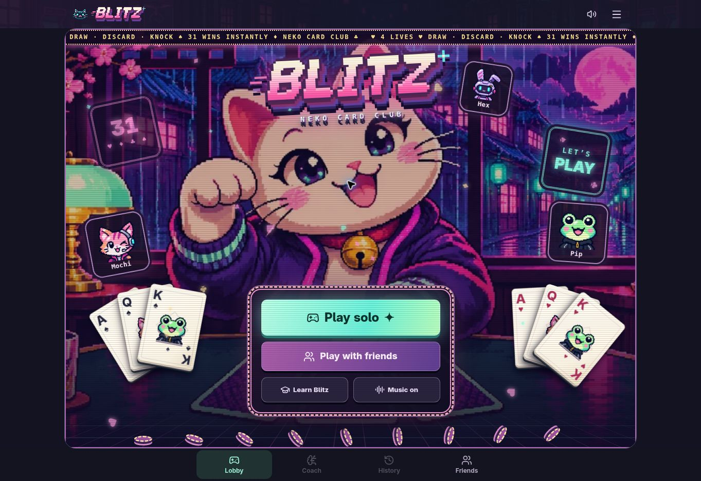

# BLITZ · Neko Card Club

A neon Thirty-One card game with a lucky-cat dealer, four lives, online friends, opponents that read the table, and a constantly evolving synth soundtrack.

[Play the game](https://neko-blitz-card-club.clintecker.chatgpt.site/) · [Rules](docs/RULES.md) · [Strategy](docs/STRATEGY.md) · [Contributing](CONTRIBUTING.md)



## At the table

- Play solo against bots or invite friends to a room. Bots fill empty seats.
- Score the best single suit in your three-card hand. A suited 31 ends the round immediately.
- Knock before drawing, including on your opening turn. Each other active player gets one final turn.
- Start with four lives. Under the default house rules, only the lowest hand pays a token. A failed knock costs one token, and triples have no bonus.
- Use the coach to compare knocking, drawing, and discarding using public information. Table-reading bots infer likely suits from visible pickups and throws.
- Learn through a skippable practice hand, then play in a layout built for phones, tablets, and desktops.
- Enable **Music** in the lobby for Glass Canopy, a procedural Web Audio score with shifting chords, drones, and glassy synth effects.
- Choose **Game menu → End game and go to lobby** to clear a solo match. Online hosts end the room for everyone. Departing guests hand their seat to a bot.

## Run locally

Extract the source ZIP and open its `neko-blitz` directory. Use Node.js 24 and npm. Python is optional and only needed to regenerate the legacy audio samples.

```sh
cd neko-blitz
npm run install:ci
npm run build
npm run db:migrate:local
npm run dev
```

Open the loopback URL printed by the dev server. Solo play uses browser storage. Online rooms use the local Cloudflare D1 emulator after the migration above. Local setup requires no GitHub or Cloudflare credentials.

```sh
npm test
npm run build
npm start
```

`npm start` previews the built Worker locally. GitHub Actions runs the test suite and production build for pushes and pull requests. The default execution profile in a clean clone is portable. The original hosted game's project identifier and local runtime state are excluded from this public export.

## Project map

| Path | Purpose |
| --- | --- |
| `app/` | React game screens, lobby, sound controls, and client state |
| `app/api/table/route.js` | Authenticated room API and revision-controlled updates |
| `public/game/table.mjs` | Pure card rules and projections that hide opponents' hands |
| `public/game/coach.mjs` | Public-information strategy model |
| `public/game/reads.mjs`, `arcade-bots.mjs` | Opponent inference and bot policy |
| `public/game/night-score.mjs`, `night-synth.mjs` | Procedural harmony and Web Audio instruments |
| `public/art/`, `public/audio/`, `public/fonts/` | Bundled artwork, legacy samples, and font assets |
| `checks/` | Automated regressions and reproducible strategy studies |
| `drizzle/`, `db/` | D1 room schema and migration |
| `worker/`, `vite.config.ts`, `scripts/` | Vinext, Cloudflare, and development tooling |

## Documentation

- [Development and troubleshooting](docs/DEVELOPMENT.md)
- [Architecture and state ownership](docs/ARCHITECTURE.md)
- [Rules and configurable variations](docs/RULES.md)
- [Strategy model and reproducible research](docs/STRATEGY.md)
- [Hosting and database deployment](docs/DEPLOYMENT.md)
- [Importing this source package into GitHub](docs/IMPORTING.md)
- [Assets, audio, and attribution](docs/ASSETS.md)
- [Security reporting](SECURITY.md), [contribution guide](CONTRIBUTING.md), [community conduct](CODE_OF_CONDUCT.md), and [changelog](CHANGELOG.md)

## License

Project code, documentation, original artwork, original synthesized audio, and the Neko Pixel font are available under the [MIT license](LICENSE). Inter retains the SIL Open Font License. Vendored software and installed dependencies retain their own licenses and attribution. See [third-party notices](THIRD_PARTY_NOTICES.md).

The game was developed with AI assistance. The illustrations were generated for this project, and the soundtrack is synthesized. This source package contains a snapshot of the hosted game from November 19, 2026. It is prepared for the intended public repository `clintecker/neko-blitz`.
